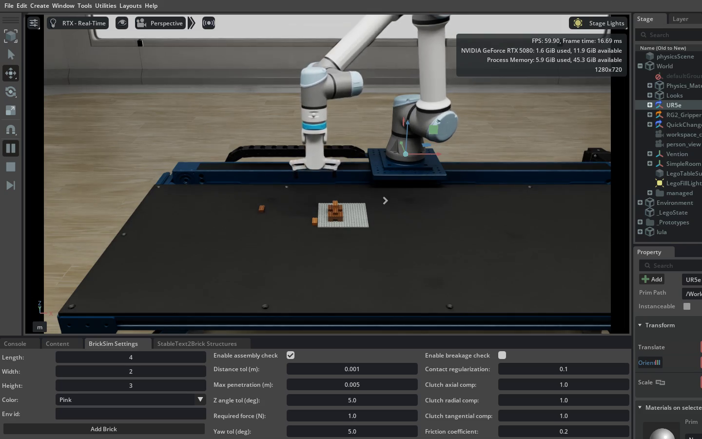
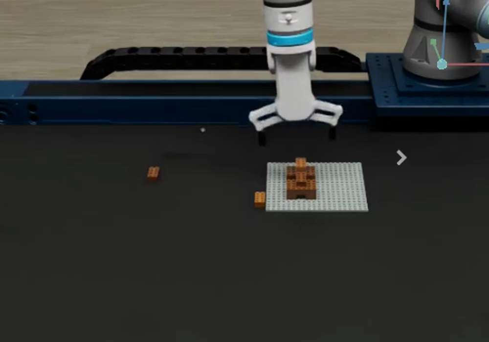
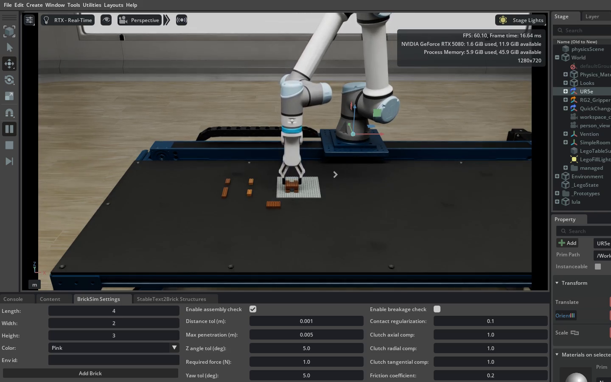
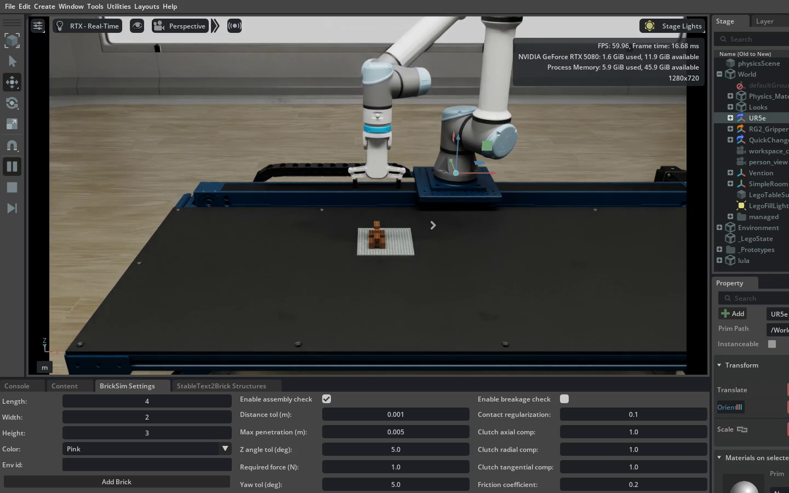
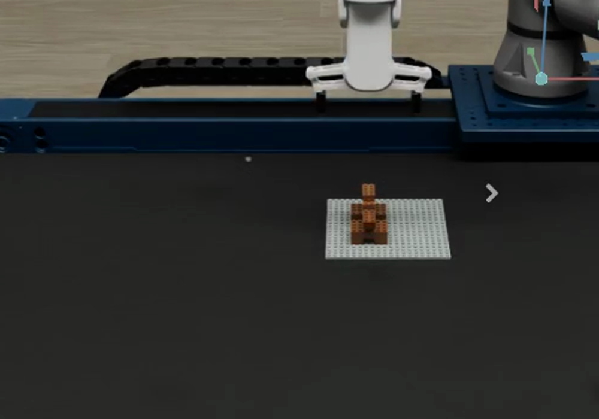

# Ten-piece dog assembly prototype

Experiment at baseline c158937. Results: see [RESULTS.md](RESULTS.md).

The robot is asked to assemble four feet, two wide body supports, a bridging torso,
a neck, head and tail on the anchored 20x20 plate. It grasps loose parts through
contact, presses them onto the previous supports and verifies expected simulator
connections after release. The original UR5e experiment files are unchanged.

## Start one attempt

From this isolated worktree, run:

    bash experiments/ur5e_dog/run_loop.sh --attempts 1

The existing parent Python 3.11 / Isaac Sim 5.1 environment and native binary are
reused, without installation. Local robot, gripper and bench assets resolve in
`/home/kaleb/isaac-workspace/isaac-mcp-assets`. The Simple Room still uses the
baseline asset-root resolver; its runtime availability has not been tested.

Run geometry checks without simulation:

    python3 -m unittest experiments.ur5e_dog.test_geometry -v
    python3 experiments/ur5e_dog/validate.py

After reviewing a successful single attempt, use `--attempts 3` for repetition.
The limit is five attempts; default timeout is 600 seconds per attempt, maximum
900 seconds. Each attempt starts a **fresh virtual scene**. This is not physical
robot disassembly, online learning or self-improving training. First failure or
timeout stops the loop. Ctrl-C terminates only this attempt's process group.

Console logs and an explicit outcome manifest go to `outputs/ur5e_dog/<time>/`.
Detailed baseline-style per-step recordings go to `outputs/ur5e_lego/`.
A completed attempt requires the controller's ten-connection success marker and
normal process exit, not merely a movie or the target geometry.

## Verified so far

- Positive geometric recipe: ten parts with ordered supports and at least four
  overlapping studs on the selected support per part.
- No solid target-brick overlap, no part outside the plate footprint, and source
  parts spaced with at least 20 mm additional planar box clearance.
- Five deliberate invalid recipes rejected; Python syntax and focused Ruff pass.
- Type checker cannot resolve 14 Isaac/Omniverse imports without generated runtime
  search paths; this is not a full type-check pass.
- All four local lab asset paths resolve. Parent native sources match this baseline.

## Limitations and next acceptance checks

The geometric validator does **not** establish gripper clearance, dynamic stability,
robot reachability, table bounds or collision-free motion. Wider 6x4 parts and a
2x8 torso are new to this controller and need single-grasp tests. The primary
support connection is checked; extra possible bridge connections are not assumed.
No success claim is justified until the real simulation recording is inspected.

Source, held-part and support poses are simulator ground truth, including XY
placement correction. Physics contacts hold the grasp, but assembly uses the
existing threshold-triggered snap/weld model and disabled breakage, not detailed
stud insertion. No final assembly poses are scripted or manually welded here.
All units match baseline: meters, radians, wxyz quaternions. Recipe offsets are
integer 8 mm studs, height dimensions are 3.2 mm plate units, and all target yaws
are zero. Simulation-only; no physical robot, ROS bridge or hardware is connected
by this launcher.

## Screenshots

Failure (runs 1–2): the head's pickup spot touched the baseplate edge, so the
gripper closed on nothing and lifted without it.

Success (run 3, all ten connections reported by the simulator):

Full recordings and logs stay local under `outputs/` (gitignored).
Screenshots are of the simulator window only.
